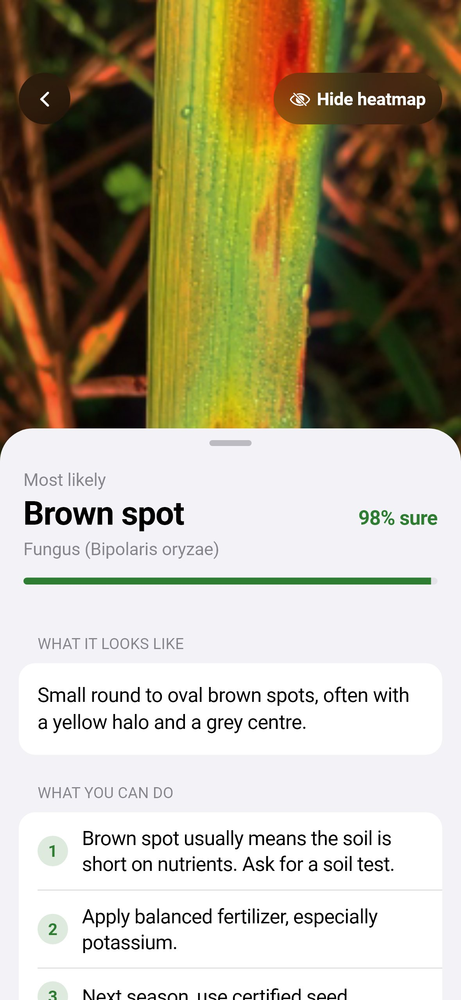
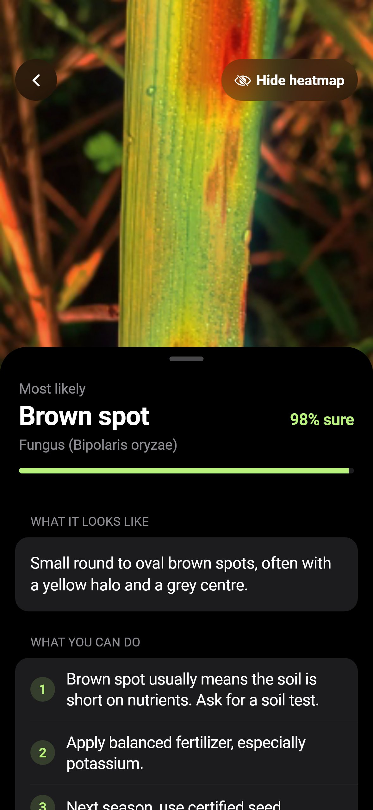
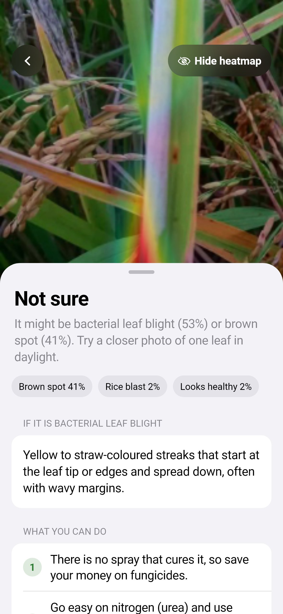
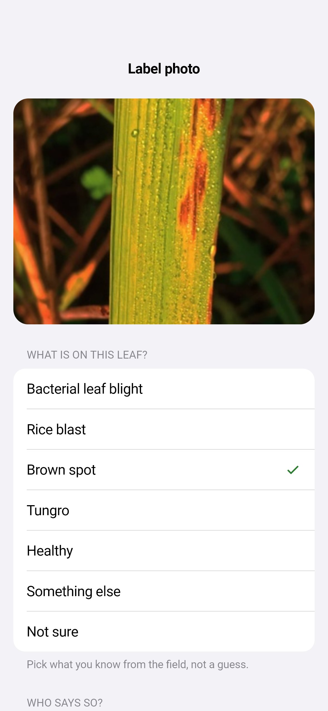
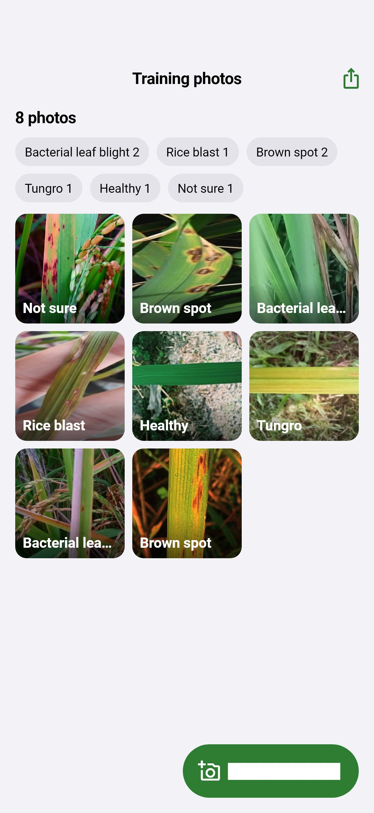

# Tanim

*Designed and built by **Kazzi** (Mark Nelson Gemina): [github.com/kazzi-dev](https://github.com/kazzi-dev)*

**An offline rice leaf disease scanner.** Point a phone at a sick rice leaf and Tanim says which disease it most likely
is (bacterial leaf blight, blast, brown spot or tungro) or that the leaf looks healthy. It also shows how sure it is and
which part of the leaf it looked at. Everything runs on the phone, so it works in the field with no signal.

*Tanim* means "to plant" in Filipino.

## Why I built this

My family has a farm and works in agriculture, so I wanted to build something that could actually help them, and farmers
like them. Farmers often have no signal in the field, so Tanim runs fully on the phone.

> Tanim is a study project, not a diagnosis. Check with your local agriculturist before treating a field.

<p>
  
  
  
  
  
</p>

| | Result |
|---|---|
| Test set (500 photos, same collections as training) | **97.6%** accuracy, 0.971 macro-F1 |
| A collection the model has never seen | **32–61%** ([why](docs/MODEL.md#never-seen-source-test-leave-one-source-out)) |
| On a phone | 3.4 MB model, about 60 ms per photo, fully offline |

## Status

- [x] Public datasets downloaded, de-duplicated and split ([dataset card](docs/DATASET.md))
- [x] Baseline model: MobileNetV3-Large, 0.98 validation macro-F1 ([model card](docs/MODEL.md))
- [x] Never-seen-source test: 0.32–0.61 accuracy, the model leans on backgrounds (see model card)
- [x] Tried tighter crops and background swapping: no reliable gain over 3 seeds; field photos are needed
- [x] ONNX export: 3.4 MB int8, 5.7 ms per photo, heatmaps built in
- [x] Flutter app: scan, result with heatmap, quality warnings ([app README](app/README.md))
- [x] Model verified on a real phone: matches Python on 10/10 photos, about 60 ms per scan
- [x] Photo collection mode: label photos in the app, export a zip, import with `ml/scripts/import_collection.py`
- [ ] Try the camera flow on a phone in a real field
- [x] Test set opened once: 97.6% ([model card](docs/MODEL.md#test-set-opened-once))
- [x] App icon; advice review sheet for an agriculturist ([docs/ADVICE_REVIEW.md](docs/ADVICE_REVIEW.md))
- [x] Portfolio case study (portfolio-kazzi, /work/tanim)
- [ ] Collect and add photos from Filipino farmers

## Layout

```
ml/
  sources.json             datasets, licences, checksums, folder → class mapping
  scripts/download.py      download + verify + extract the datasets
  scripts/build_dataset.py de-duplicate and split → ml/data/manifest.csv
  scripts/train.py         fine-tune a pretrained backbone → ml/runs/<name>/
  scripts/import_collection.py  add photos exported from the app as the ph_field source
  scripts/make_masks.py    cut leaves out of plain-background photos for --swap-bg
  scripts/evaluate_test.py score the final model on the locked test split (once)
  scripts/heatmaps.py      draw what the model looks at on validation images
  scripts/export.py        ONNX export + int8 quantization + checks → ml/export/<run>/
  scripts/make_app_fixtures.py  test photos + expected outputs for the app tests
  scripts/common.py        shared dataset, model and metrics code
  data/                    (git-ignored) downloads, raw images, manifest
app/                       Flutter app (Android, iOS); runs the model with ONNX Runtime
docs/
  DATASET.md               where the images come from and what's wrong with them
  MODEL.md                 model, training setup and results
```

## Build the dataset

Needs Python 3.12 and about 1.5 GB of disk space. On Windows the scripts use the built-in `tar.exe` to extract the zip,
7z and rar archives.

```bash
python -m venv .venv
.venv/Scripts/python -m pip install -r ml/requirements.txt
.venv/Scripts/python ml/scripts/download.py
.venv/Scripts/python ml/scripts/build_dataset.py
```

(On macOS or Linux use `.venv/bin/python`.) The result is `ml/data/manifest.csv`, with one row per kept image giving
its path, label, source and split.

## Train

Install PyTorch with CUDA first for GPU training (the CPU build works too, just slower):

```bash
.venv/Scripts/python -m pip install torch torchvision --index-url https://download.pytorch.org/whl/cu128
.venv/Scripts/python ml/scripts/train.py --arch mobilenet_v3_large
.venv/Scripts/python ml/scripts/heatmaps.py mobilenet_v3_large
.venv/Scripts/python ml/scripts/train.py --holdout bd5 --name loso_bd5   # never-seen-source test
.venv/Scripts/python ml/scripts/export.py mobilenet_v3_large
```

## Credits

The images are from three CC BY 4.0 datasets on Mendeley Data: Sethy et al. (2020), RiceLeafBD and RiceLeafDisease-BD5.
See [docs/DATASET.md](docs/DATASET.md) for full citations.
