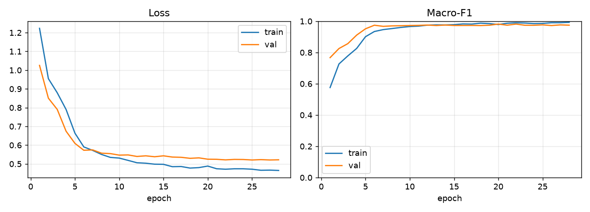
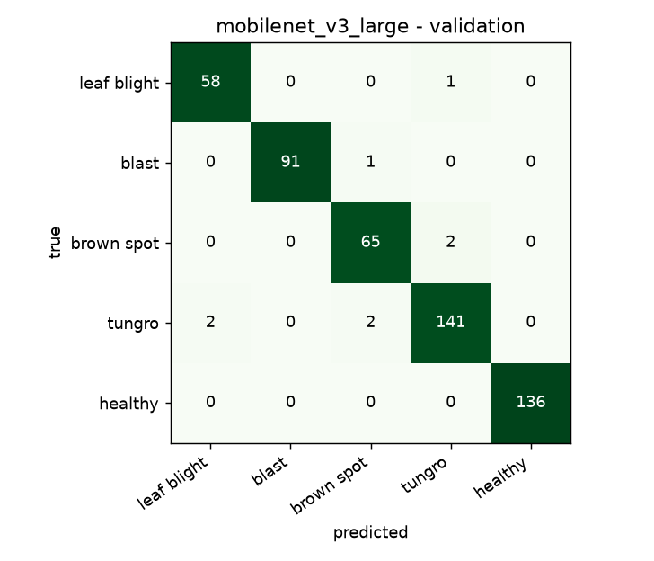
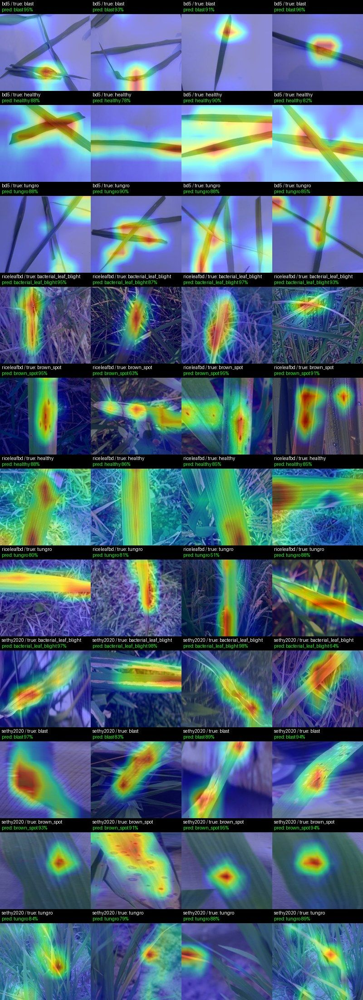
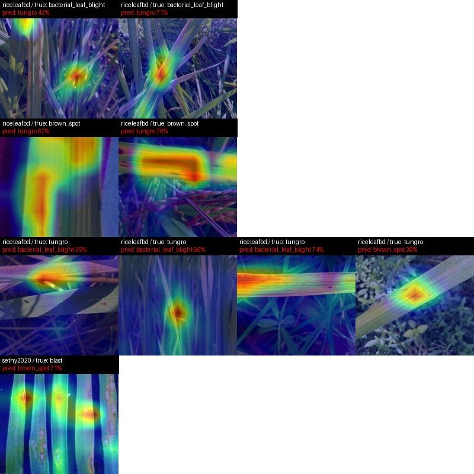

# Model card

## v0 baseline: MobileNetV3-Large

| | |
|---|---|
| Backbone | MobileNetV3-Large, ImageNet-pretrained (torchvision) |
| Head | global average pool → dropout 0.3 → one linear layer (5 classes) |
| Size | 2.98 M parameters, 11.9 MB in fp32 (before quantization) |
| Input | 224 × 224 RGB, ImageNet normalization |
| Training | `ml/scripts/train.py --arch mobilenet_v3_large` on an RTX 4070 Laptop, about 4 s per epoch |

The single linear head is deliberate. With it, the heatmap for class *c* is just `sum_k fc.weight[c, k] * features[k]`,
so the phone can draw it without computing gradients.

### Training

- Stage 1: backbone frozen, head only, 3 epochs, AdamW lr 1e-3
- Stage 2: everything, AdamW (backbone lr 1.5e-4, head lr 3e-4), 1 epoch warm-up then cosine, early stop after 8
  epochs without improvement
- Class-weighted cross-entropy with label smoothing 0.1
- Augmentation: random resized crop (40–100%), horizontal and vertical flips, rotation up to 30°, colour jitter, blur
- Best epoch: 20 of 28

### Validation results

These are **validation** numbers (499 images). The test split hasn't been opened yet; it's saved for the final model.

| Class | Precision | Recall | F1 | n |
|---|---:|---:|---:|---:|
| bacterial_leaf_blight | 0.97 | 0.98 | 0.97 | 59 |
| blast | 1.00 | 0.99 | 0.99 | 92 |
| brown_spot | 0.96 | 0.97 | 0.96 | 67 |
| tungro | 0.98 | 0.97 | 0.98 | 145 |
| healthy | 1.00 | 1.00 | 1.00 | 136 |
| **macro** | | | **0.982** | 499 |

| Source | Accuracy |
|---|---:|
| bd5 (white paper backgrounds) | 1.000 |
| riceleafbd (field) | 0.967 |
| sethy2020 | 0.980 (small: about 50 images) |

EfficientNet-B0 scored about the same (macro-F1 0.977) while being 35% larger, so MobileNetV3-Large is the pick for
now.

### What the heatmaps show

- On most images the attention sits on the leaf and its lesions, not the background. That includes BD5's white paper
  photos, and for brown spot it lands on the spots themselves.
- On healthy field photos some attention spreads onto the surrounding grass.
- The 9 mistakes are look-alike pairs: tungro ↔ bacterial leaf blight (both yellow the leaf) and blast → brown spot.

### Why 98% is not the real number

The validation photos come from the same three datasets, cameras and fields as the training photos. A 2-epoch
smoke-test model recognized 94% of BD5 blast photos but **0%** of Sethy blast photos, which shows how much the source
matters early on. The number that counts will come from photos the model has never seen the like of: Filipino farmers'
phones in Philippine fields.

### Never-seen source test (leave one source out)

Three extra runs, each trained with one source removed completely, then scored on that source's train and val images
(its test images stay unread). This is the closest stand-in we have for "photos from a new place and a new phone".

| Left out | Accuracy on it | Macro-F1 | What went wrong |
|---|---:|---:|---|
| bd5 (leaves on white paper) | 0.32 | 0.34 | Healthy leaves → **blast** (471 of 556). Blast then came only from Sethy, whose blast photos also have plain light backgrounds |
| riceleafbd (field) | 0.47 | 0.43 | Healthy field leaves → **bacterial leaf blight** (179 of 214). Healthy had only been seen on white paper |
| sethy2020 | 0.61 | 0.53 | Blast recall **0.00**: blast had only been seen on BD5's paper, so field blast → blight or brown spot |

Healthy recall was 0.04 and 0.01 in the first two runs. **The model links classes to backgrounds**, not only to
symptoms: "plain light background" has become part of what *blast* and *healthy* mean to it. Inside the mixed
validation set this doesn't show, because each class appears with the same backgrounds in training and validation.

Expect real farmer photos to land somewhere between these numbers and the 0.98 above until this is fixed. Ways to fix it:

- Train on leaves cut out from their backgrounds and pasted onto mixed backgrounds (needs leaf masks; RiceSeg-5932 has
  masks for the Sethy images)
- Tighter crops during training, so lesions fill the frame and the background has less to say
- Photos of every class in the field, which is exactly what the farmer photos will bring

Re-run with `train.py --holdout <source>` after each change: this is the number to push up.

## Export

`ml/scripts/export.py <run>` writes an ONNX model the app runs with ONNX Runtime. Normalization, softmax and
per-class heatmaps are built into the graph:

- input `image`: float32 `[1, 3, 224, 224]`, RGB 0..1, resized (short side 224) and centre-cropped
- output `probs`: float32 `[1, 5]`
- output `cams`: float32 `[1, 5, 7, 7]`. Take the top class, clamp below 0, divide by the max, stretch over the photo

| | Size | Val macro-F1 | Median time (1 CPU thread, laptop) |
|---|---:|---:|---:|
| PyTorch (bf16 on GPU) | – | 0.982 | – |
| ONNX fp32 | 12.2 MB | 0.979 | 6.4 ms |
| **ONNX int8** | **3.4 MB** | **0.984** | **5.7 ms** |

fp32 ONNX matches PyTorch to 1e-7 on the probabilities. int8 agrees with fp32 on 99.4% of validation images, and its
heatmaps correlate with fp32's at a median of 0.96.

Quantization needed one fix: default min/max calibration dropped val macro-F1 to **0.69**, because a few extreme
activations (MobileNetV3's hard-swish and squeeze-excite layers) stretched the int8 range. Calibrating at the 99.99th
percentile brings it back.

## Next

- Reduce the background shortcut (see above) and re-check with the never-seen-source runs
- Flutter app with ONNX Runtime
- Open the test split once, for the final model only
